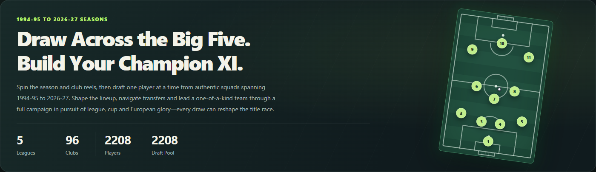
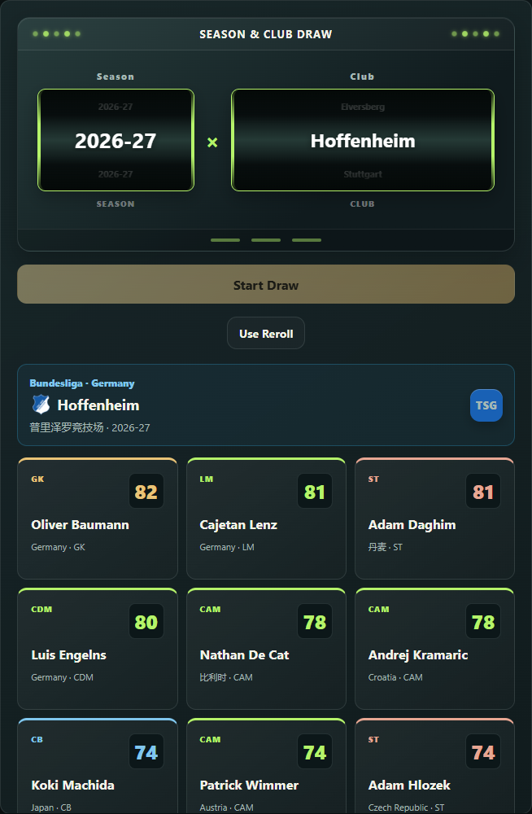
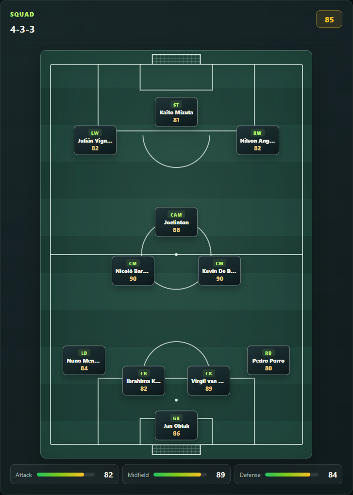
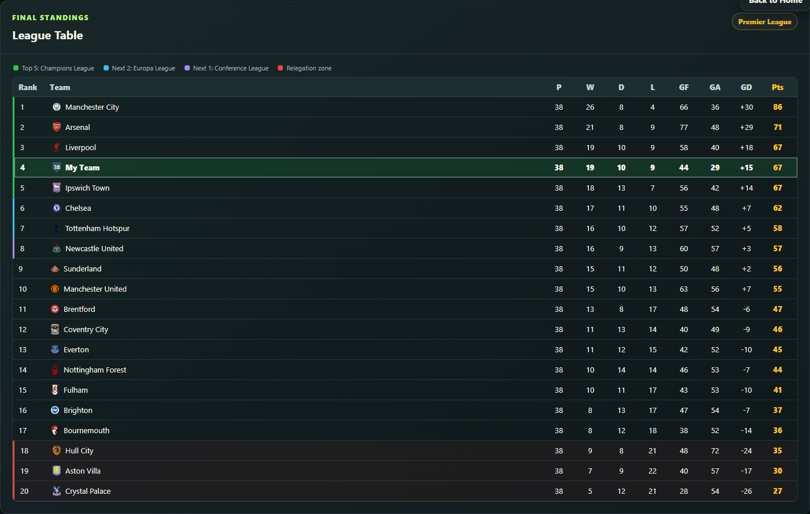

# Global 38-0 | Global All-Stars

**Bring stars from different eras into one starting XI.**

Draft across seasons, shape your squad, and chase league, cup, and European glory.

[Play online](https://nordlicht-zhc.github.io/global-38-0/) · [Download for Windows](https://github.com/Nordlicht-zhc/global-38-0/releases/latest) · [简体中文](README.md)

## From your first draw to the final whistle

- **Draft across eras:** Pick players from Europe's five major leagues across the 1994-95 to 2026-27 seasons, bringing stars from different generations together.
- **Build your team:** Adjust formations, choose a coach, and strengthen weak positions through transfers, free signings, and loans.
- **Compete for trophies:** Play league, domestic cup, and European campaigns, then review standings, match results, and player statistics.
- **Make your mark:** Unlock achievements, keep season records, and save progress locally. Classic/Challenge and Dynasty have separate save slots.

## Choose your journey

| Classic | Challenge | Dynasty |
| :--- | :--- | :--- |
| Draft your starting eleven and chase a single-season title. | Find new ways to win under squad restrictions and special objectives. | Keep your squad across seasons and navigate promotion, relegation, and transfers in the Three-Tier Journey. |

## Your squad. Your decisions.

<table>
  <tr>
    <td width="50%" valign="top"><strong>Draw a club. Find your next key player.</strong>  </td>
    <td width="50%" valign="top"><strong>Find the right place for every player.</strong>  </td>
  </tr>
</table>

See the league table after a full season

