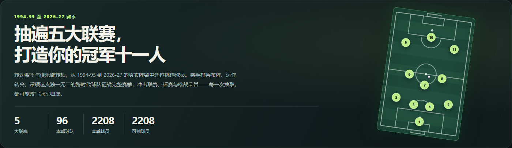
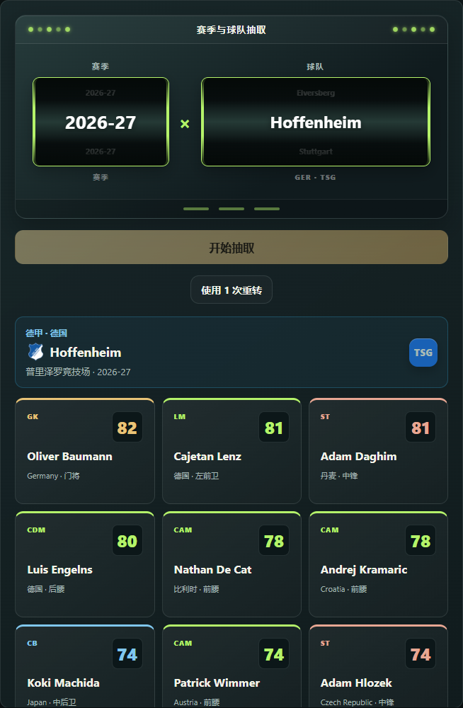
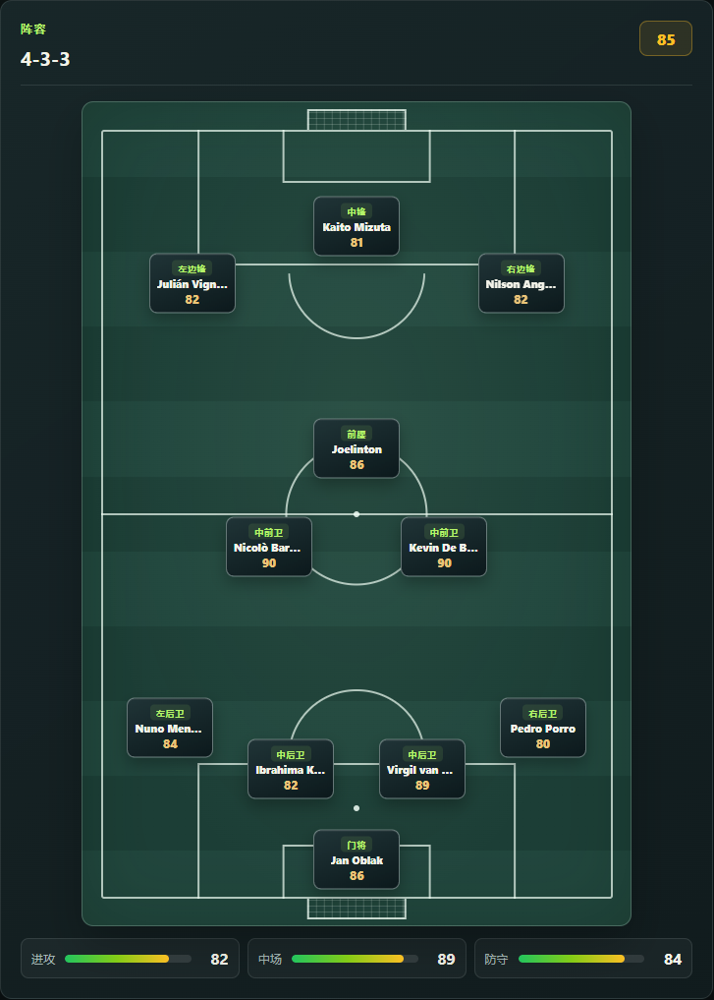
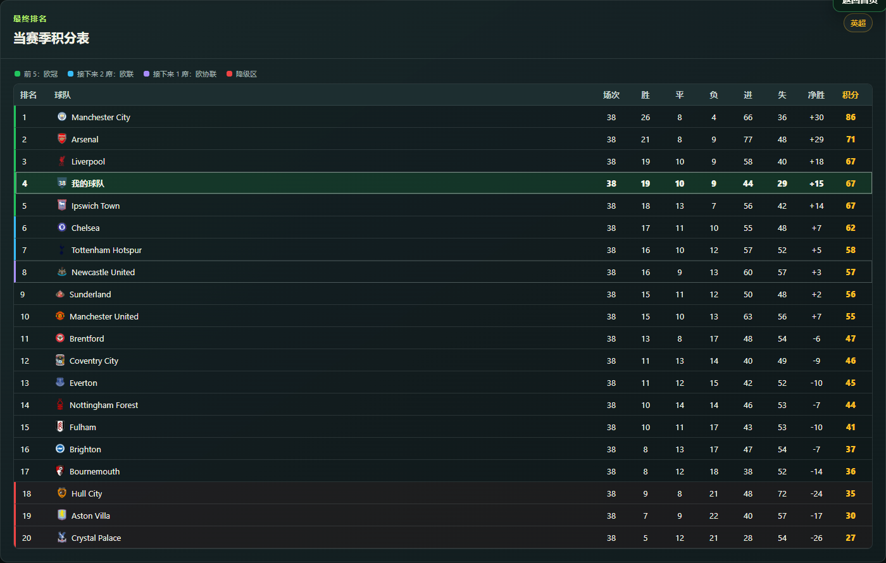

# Global 38-0｜全球全明星赛季

**把不同时代的球星，放进同一张首发名单。**

跨赛季选秀、经营球队，向联赛、杯赛与欧战冠军发起挑战。

[在线游玩](https://nordlicht-zhc.github.io/global-38-0/) · [下载 Windows 便携版](https://github.com/Nordlicht-zhc/global-38-0/releases/latest) · [English](README.en.md)

## 从一次抽取，到一个冠军赛季

- **跨时代选秀**：从 1994-95 至 2026-27 赛季的五大联赛阵容中挑选球员，让不同时代的球星并肩作战。
- **亲手经营球队**：调整阵型、选择教练，通过转会、自由签约与租借补齐阵容短板。
- **征战完整赛事**：参加联赛、国内杯赛和欧洲赛事，通过积分榜、赛果与球员统计回顾球队表现。
- **留下你的战绩**：解锁成就、保存赛季记录，自动保存本地进度；经典／挑战与王朝模式分别存档。

## 选择你的征途

| 经典模式 | 挑战模式 | 王朝模式 |
| :--- | :--- | :--- |
| 从选秀开始，组建十一人，冲击单赛季冠军。 | 在阵容限制与特殊目标下，寻找不同的取胜方式。 | 保留阵容跨赛季经营，体验三级征途的升降级与转会。 |

## 球队，由你打造

<table>
  <tr>
    <td width="50%" valign="top"><strong>抽取俱乐部，挑选下一位核心</strong>  </td>
    <td width="50%" valign="top"><strong>排兵布阵，让十一人各就其位</strong>  </td>
  </tr>
</table>

看看一个赛季结束后的积分榜

